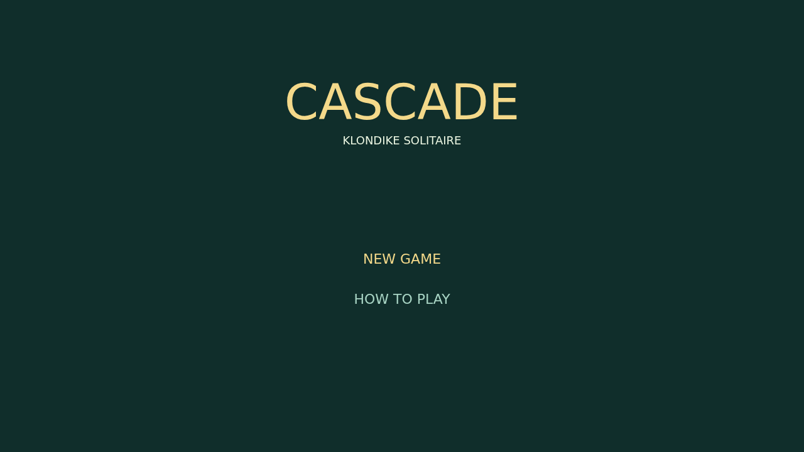
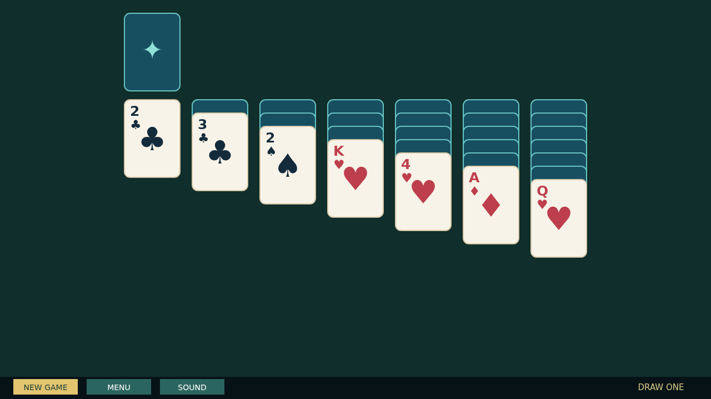

# Cascade

Cascade is a calm, tactile Draw One Klondike solitaire played on a deep felt table. Every card is dealt into a readable tableau, with the stock and waste close at hand and four foundations waiting above.

Move cards and ordered runs down the columns in alternating colors. Reveal the face-down cards, turn the stock one card at a time, and build each foundation from ACE through KING. A DOUBLE-CLICK sends a playable card home when its foundation is ready.

When the last card reaches a foundation, the table erupts. The completed foundations launch their cards in a looping cycle; each card arcs, bounces, and leaves a painted trail as it drifts beyond the edge.

